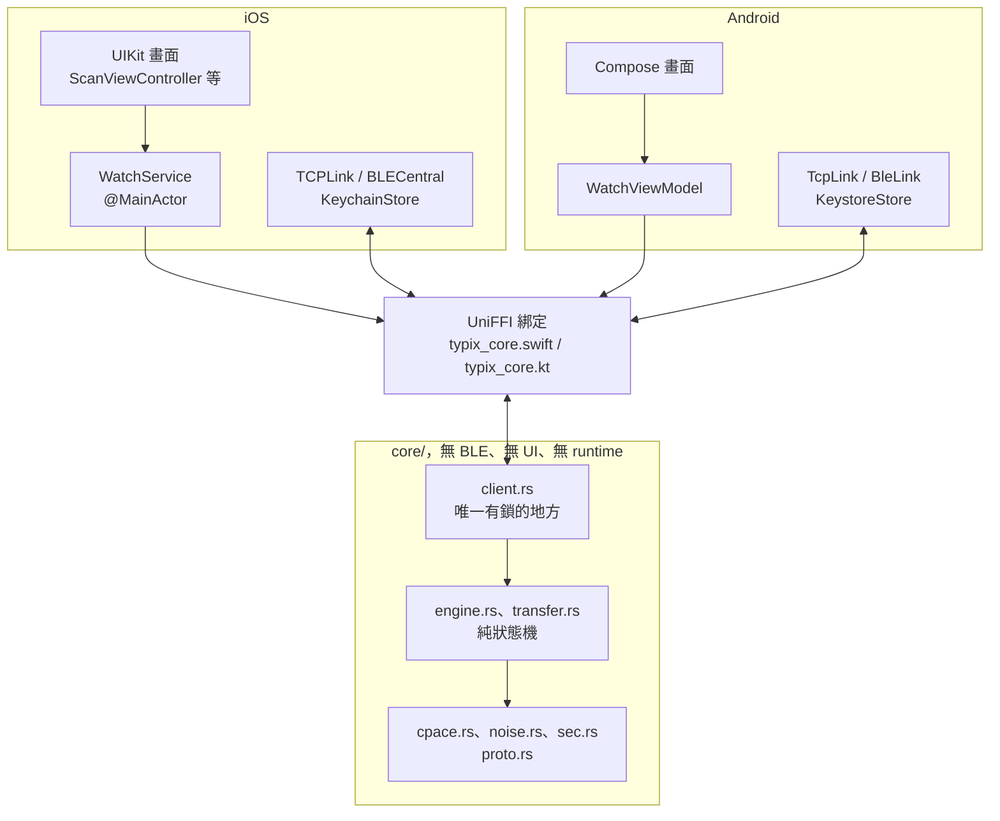
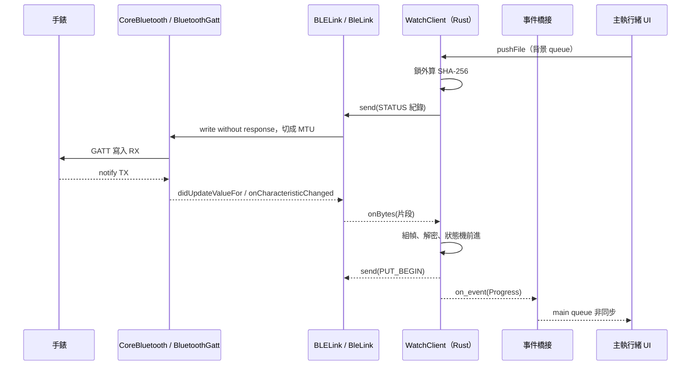
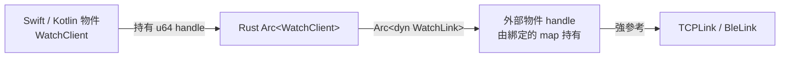
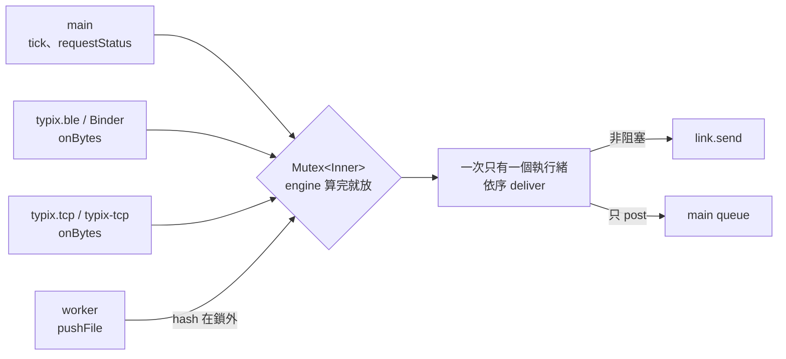
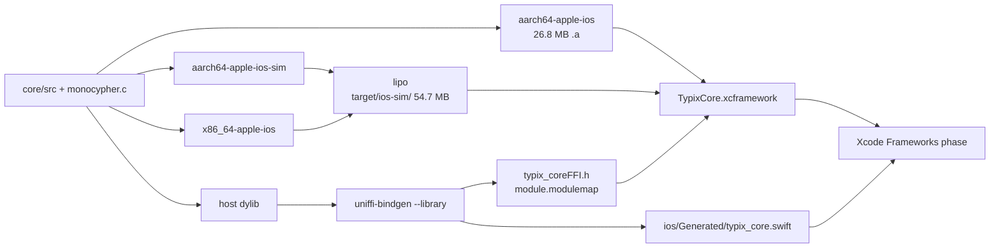
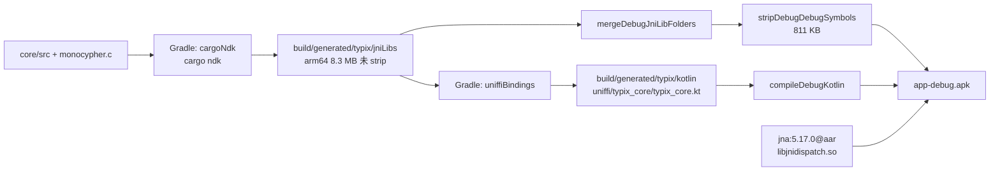
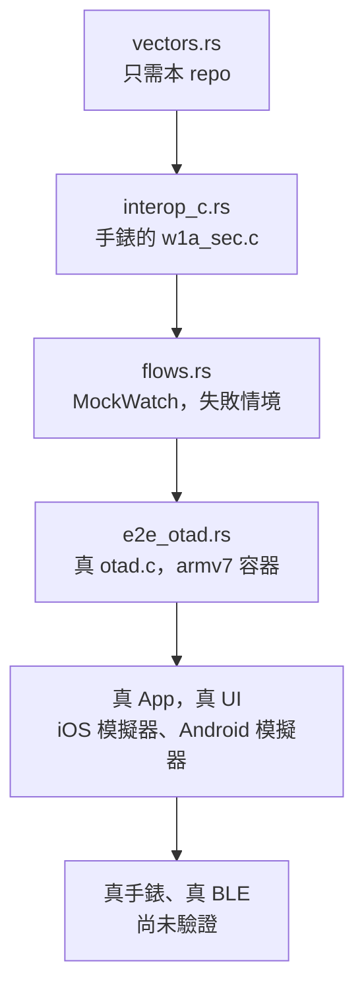

# Typix Watch 架構與跨語言教程

這份文件講 App 怎麼從 UIKit／Kotlin 穿過 UniFFI 進到 Rust，再回來。堆疊、路徑、大小都是實際跑出來的（2026-10-31，Xcode 27.2、rustc 1.95、Gradle 9.2.0、AGP 9.0.0、NDK 27.1），只有標「未實測」的段落例外。

## 1. 分層



Rust 不知道 BLE 存在。它只看到一條能送位元組的 `WatchLink`。背景連線、權限、藍牙配對這些事都屬於作業系統，所以留在平台層。

`engine.rs` 是 sans-IO：位元組進來，`Output` 出去，時間是一個傳入的數字。它不開 socket、不開執行緒、不碰鎖，所以測試能一步步驅動它，超時也能用假時鐘測。

## 2. 跨語言 callstack

### 2.1 往下：UI 呼叫 Rust

這是在模擬器上用 lldb 停在 `uniffi_typix_core_fn_method_watchclient_tick` 的真實堆疊（Debug App，Rust 是 release 加行號表）：

```text
* thread #1, queue = 'com.apple.main-thread'
  frame #0: uniffi_typix_core_fn_method_watchclient_tick at client.rs:83
  frame #1: closure #1 in WatchClient.tick(uniffiCallStatus:) at typix_core.swift:1723
  frame #2: makeRustCall<(), Never>
  frame #3: rustCall<()>
  frame #4: WatchClient.tick() at typix_core.swift:1721
  frame #5: closure #1 in WatchService.startTimer
  frame #7: Foundation`__NSFireTimer
  frame #8: CoreFoundation`__CFRUNLOOP_IS_CALLING_OUT_TO_A_TIMER_CALLBACK_FUNCTION__
```

再往裡，符號 `uniffi_…_tick` 展開成 UniFFI 的樣板，注意最外層的 `catch_unwind`：

```text
frame #4: into_arc<WatchClient> at handle.rs:71      把 handle 轉回 Arc
frame #6: try_lift<WatchClient>                      參數從 C 型別還原
frame #9: {closure#1} at client.rs:83
frame #11: catch_unwind<Result<(), RustCallError>>   panic 停在這裡
```

每個 Rust 方法都是一個 `extern "C"` 符號。Swift 傳 C 能表達的東西：物件是 `UInt64` handle，`Data` 是 `RustBuffer`，最後加一個 `RustCallStatus*` 用來帶回錯誤。Android 走同一個 C ABI，只是經過 JNA。

### 2.2 往上：網路回呼經 Rust 回到 Swift

停在 `EventBridge.onEvent`，同一個執行緒上 Swift → Rust → Swift：

```text
* thread #6, queue = 'typix.tcp'
  frame #0:  EventBridge.onEvent(event=status) at WatchService.swift:193
  frame #2:  closure #1(uniffiHandle=1, event=RustBuffer)     綁定解開參數
  frame #6:  uniffiTraitInterfaceCall<()>                     Swift 例外轉 callStatus
  frame #7:  closure #3(uniffiHandle=1, ...)                  vtable 裡的 C 函式
  frame #9:  on_event                                         Rust 呼叫外部 trait
  frame #10: deliver                                          client.rs，此時已放鎖
  frame #11: on_bytes                                         client.rs
  frame #12: rust_call<...on_bytes...>
  frame #13: uniffi_typix_core_fn_method_watchclient_on_bytes
  frame #14: closure #1 in WatchClient.onBytes at typix_core.swift:1626
  frame #17: WatchClient.onBytes(bytes=269 bytes) at typix_core.swift:1624
  frame #18: closure #1 in WatchService.open at WatchService.swift:119
  frame #19: closure #1 in TCPLink.receive
  frame #20: Network`...
```

重點是 `frame #10`：`deliver` 在鎖外。原因見第 3 節。

### 2.3 BLE 的完整來回



### 2.4 錯誤怎麼穿過邊界

| 情況 | Rust 這邊 | Swift | Kotlin |
|---|---|---|---|
| 同步方法失敗 | `Err(CoreError)` | `throw CoreError.Busy` | `throw CoreException.Busy` |
| 操作進行中失敗 | `WatchEvent::Failed` | 事件 `.failed(error:)` | `WatchEvent.Failed` |
| 平台回呼失敗 | 收到 `Err(CoreError)` | `throw` | `throw` |
| Rust panic，方法宣告 `throws` | `catch_unwind` 轉 status 2 | `UniffiInternalError.rustPanic` | `InternalException` |
| Rust panic，方法沒宣告 `throws` | 同上 | `try!`：**App 崩潰** | 例外往上丟 |

最後一列要記住。`tick()` 綁定出來是 `try! rustCall`（`typix_core.swift:1721`），而 `tick` 在主執行緒跑。所以 core 的執行路徑一律回 `Result`，不用 `unwrap`，鎖中毒也用 `into_inner` 接住。

手錶多半用**關閉連線**表達拒絕，不回錯誤。同一個關閉的意義取決於當時的階段，由 `Engine::on_closed` 決定：

| 關閉時的階段 | 錯誤 |
|---|---|
| 等 sid | `PairingNotOpen` |
| 等確認 | `WrongCode` |
| 等 Noise 訊息 2 | `SessionRejected` |
| 其他 | `LinkClosed` |

Noise 訊息 2 **解不開**才是 `WatchKeyMismatch`。「手錶不認識這支手機」和「這不是配對過的手錶」是完全不同的事，所以分成兩個錯誤。

分級也重要：`Remote`（手錶拒絕）只結束這個工作，session 還能用；`Protocol`（對方說了不該說的話）關閉連線。中途失敗時還在途中的回覆靠 `pending` 計數丟棄，因為回覆保證照順序。

### 2.5 取消

沒有 async，所以沒有 future 可以 cancel。取消是明確的動作：

| 動作 | 效果 | 手錶上的暫存 |
|---|---|---|
| `disconnect()` | 關連線 | 保留，下次續傳 |
| `abort_push()` | 送 `PUT_ABORT`，等在途回覆排完才回 `PushAborted` | 刪除 |
| 超時 | `tick` 發現 deadline 過了，關連線 | 保留 |

pull 失敗一律呼叫 `sink.finish(false)`，呼叫端才知道要丟掉資料。`PullJob::abandon` 保證這件事只發生一次，涵蓋連線中斷。

### 2.6 生命週期



- Rust 物件：Swift 在 `deinit` 釋放，Kotlin 由 `JNA Cleaner` 執行緒回收（實測的執行緒清單看得到它），也可手動 `close()`。
- 外部物件：傳進 Rust 時進入綁定的 handle map，Rust 的 `Arc` 歸零才移除。`link` 存在 `Inner` 裡直到被換掉，所以 Rust 會讓它活著。
- 這造成一個實際踩到的限制：UniFFI 給每個 Kotlin 介面加了 `close()`（`Disposable`），和原本的 `WatchLink.close` 衝突，編譯時報 `Conflicting overloads`，所以 Rust 方法叫 `close_link`。
- 舊連線的遲到位元組：平台層用 `LinkHolder.alive`（iOS）和 `current === link`（Android）擋掉，否則舊 socket 的資料會餵進新 session。

## 3. 執行緒模型

### 3.1 誰在哪裡跑

**Rust 沒有 runtime。** 沒有 tokio，沒有 async export，core 自己不開任何執行緒。所有 Rust 程式碼都跑在呼叫者的執行緒上。Android 上實測的執行緒清單（`/proc/<pid>/task/*/comm`，連線中）：

```text
typixnode.watch   主執行緒
typix-tcp         TcpLink 讀取迴圈，呼叫 onBytes
pool-2-thread-1   TcpLink 寫入 executor
pool-5-thread-1   WatchViewModel 的 worker（pushFile）
binder:6784_1..4  Binder 執行緒，BLE 回呼落在這裡
JNA Cleaner       回收 Rust handle
```

| 呼叫者 | iOS | Android | 碰鎖 | 可否久等 |
|---|---|---|---|---|
| UI、計時器（`tick`） | main | main | 是 | 不可 |
| `request_status` 等短呼叫 | main | main | 是 | 不可 |
| 收到位元組 | `typix.tcp`、`typix.ble` | `typix-tcp`、Binder | 是 | 短 |
| `push_file`（算 hash） | `typix.worker` | `pool-5` | 只在前後 | 可以 |
| 事件 | 呼叫 `drive` 的執行緒 | 同左 | 否 | 不可，只能 post |



### 3.2 只有一把鎖，規則有三條

`client.rs` 的 `drive()` 是全部的併發邏輯：

```rust
let mut g = self.lock();
let result = f(&mut g.engine);              // 持鎖：純計算
g.queue.extend(g.engine.take_outputs());
if g.dispatching { return result; }         // 別人在送，交給他
g.dispatching = true;
while let Some(output) = g.queue.pop_front() {
    drop(g);                                // 放鎖才碰平台
    self.deliver(output, link);
    g = self.lock();
}
g.dispatching = false;
```

**規則一：呼叫平台之前放鎖。** `send` 在 Swift 或 Kotlin 裡可能同步回呼 `on_bytes`，持鎖就會自鎖。`a_link_may_call_back_from_inside_send` 測這條，用的是在 `send` 裡直接回呼的 Loopback link。

**規則二：一次只有一個執行緒送。** 這條最容易被忽略。紀錄的 nonce 是連號的，兩個執行緒同時放鎖去送，就可能把紀錄 N+1 排在 N 前面，手錶解密失敗後關閉 session。所以 `dispatching` 為真時，其他執行緒把輸出留在佇列就走，由正在送的執行緒帶走。

**規則三：長工作不持鎖。** 這條是寫這份文件時查出的問題：原本 `push_file` 在鎖內算整個檔案的 SHA-256，主執行緒的 `tick` 會卡在這把鎖上。現在 `push_context()` 拿到參數就放鎖，建好 `PushJob` 再回來 `start_push`。`hashing_does_not_hold_the_client_lock` 在 `read_at` 裡呼叫 `tick`，有回歸就會死鎖。若其間別人開始了操作，`start_push` 回 `Busy`。

### 3.3 例外：持鎖呼叫的外部 trait

`ByteSource.read_at` 和 `ByteSink.write`／`finish` 是在持鎖時呼叫的，因為狀態機要同步拿到資料。代價：

- 實作**不可**回呼 client，否則死鎖。trait 的文件有寫。
- 實作要快。`MemorySource` 和 `MemorySink` 只讀寫記憶體，`finish` 只 post。

這是刻意的取捨：`read_at` 走鎖外要把狀態機拆成等待回呼的狀態，換來的只是不需要的通用性。v1 的來源都在記憶體內（手錶上限 15 MB）。若要串流大檔，再改成先讀好才進鎖。

### 3.4 為什麼不用 async

UniFFI 能綁 `async fn` 到 Swift `async` 和 Kotlin `suspend`。這裡不用：

1. 真正的 I/O 都在平台層，Rust 沒有東西可以 await。
2. sans-IO 加同步呼叫，延遲和順序都能在紙上推論。
3. 引入 runtime 等於多一組執行緒和多一組生命週期要跨邊界管理。

代價是超時要靠 `tick()`。平台每秒呼叫一次，這是 core 唯一的時鐘（iOS 在 `WatchService.startTimer`，Android 在 `ticker`）。

### 3.5 不阻塞 UI

| 風險 | 處理 |
|---|---|
| `tick` 等鎖 | 鎖內只有解密、狀態機和讀一塊記憶體，沒有 I/O。實際耗時未量測 |
| main 恰好成為送出者 | `send` 只排隊（`queue.async`、`writer.execute`、`NWConnection.send`），事件只 post |
| 算 hash | 背景 queue，且不持鎖 |
| 事件順序 | iOS 用 `DispatchQueue.main.async`，不用 `Task`，因為 `Task` 不保證 FIFO |
| Keychain／Keystore | 配對時寫一次，啟動時讀；`SavePin` 在 `deliver` 內，鎖外 |

Android 例外：`BleLink.pump` 在呼叫者執行緒上做 `writeCharacteristic`，它是快速的本機 Binder 呼叫，但主執行緒發起的請求會走這條。

### 3.6 Android 的 Binder 回呼

`BluetoothGattCallback` 落在 Binder 執行緒池，呼叫 `client.onBytes` 時 JNA 把 Rust 跑在該執行緒上。回呼要盡快返回，否則拖住 Binder 池，所以 Rust 這邊只做解密和排隊。Android 一次只允許一個 GATT 寫入，`BleLink` 把片段排在佇列，從 `onCharacteristicWrite` 接續。

CoreBluetooth 則是 delegate 全部在指定的 `typix.ble` 串列 queue 上，`BLELink` 的狀態都留在這個 queue，不用鎖。

## 4. 編譯與連結

### 4.1 Rust 的三種產物

`core/Cargo.toml`：

```toml
[lib]
crate-type = ["lib", "staticlib", "cdylib"]
```

| 型別 | 誰用 | 為什麼 |
|---|---|---|
| `lib` | `cargo test` | Rust 測試要連它 |
| `staticlib` | iOS | 連進 App 本體，Xcode 可 dead-strip |
| `cdylib` | Android | JNA 要動態載入 `.so`；UniFFI 也從這裡讀 metadata |

`build.rs` 用 `cc` 編譯 `vendor/monocypher/monocypher.c`，它是連到 Rust 的 C。cargo 會帶好交叉編譯器，所以 iOS 和 NDK 都不用另外設定。

### 4.2 iOS



`scripts/build-ios.sh` 做的事：

```sh
export IPHONEOS_DEPLOYMENT_TARGET=16.0
cargo build --release --lib --target aarch64-apple-ios-sim
cargo build --release --lib --target x86_64-apple-ios
cargo build --release --lib --target aarch64-apple-ios
cargo build --release --lib                     # 給 bindgen 讀 metadata
cargo run --features bindgen --bin uniffi-bindgen -- generate \
    --library target/release/libtypix_core.dylib --language swift --out-dir ...
lipo -create -output target/ios-sim/libtypix_core.a <兩個模擬器 .a>
xcodebuild -create-xcframework \
    -library target/ios-sim/libtypix_core.a -headers <h> \
    -library target/aarch64-apple-ios/release/libtypix_core.a -headers <h> \
    -output ios/Frameworks/TypixCore.xcframework
```

全新建置約 70 秒。為什麼模擬器要 lipo：`-create-xcframework` 不接受同平台的兩個 library，要先合併。

產物：

```text
ios/Frameworks/TypixCore.xcframework/
    Info.plist
    ios-arm64/{Headers, libtypix_core.a}                       arm64
    ios-arm64_x86_64-simulator/{Headers, libtypix_core.a}      x86_64 arm64
ios/Generated/{typix_core.swift, Manrope-*.otf}
```

Xcode 專案的 build phase 只有三個：Sources、Frameworks、Resources。**沒有 Run Script phase**：Rust 由上面的腳本先建好，改了 core 要重跑。這樣 Xcode 建置不需要 cargo，也不受 `ENABLE_USER_SCRIPT_SANDBOXING` 影響。`.a` 有 26 MB，但 App 只留用到的部分，Release 裝置版執行檔是 1.7 MB，含全部 Swift。

專案用 Xcode 16 起的 `PBXFileSystemSynchronizedRootGroup`，`TypixWatch/`、`Generated/` 的檔案自動進 target，新增檔案不用改 `project.pbxproj`。Debug 版 Swift 與 Rust 都進 `TypixWatch.debug.dylib`（3.6 MB），堆疊裡看到的就是它，主執行檔只有 40 KB 的啟動器。

實際跑過的建置指令（Team 留空，不需要憑證）：

```sh
cd ios
# 模擬器，ad-hoc 簽名
xcodebuild -project TypixWatch.xcodeproj -scheme TypixWatch \
    -sdk iphonesimulator -destination "generic/platform=iOS Simulator" \
    -derivedDataPath ../core/target/ios-dd \
    CODE_SIGN_IDENTITY=- ARCHS=arm64 ONLY_ACTIVE_ARCH=NO build
# 裝置 arm64，只驗證編譯連結，不簽名
xcodebuild -project TypixWatch.xcodeproj -scheme TypixWatch \
    -sdk iphoneos -configuration Release -destination generic/platform=iOS \
    -derivedDataPath ../core/target/ios-dd CODE_SIGNING_ALLOWED=NO build
```

模擬器要用 `-sdk` 加 generic destination，因為這台 host 的 CoreSimulator 比 Xcode 舊，用 `name=iPhone 17 Pro` 會報 `Unable to find a device`。

### 4.3 Android



建置只要一行，`preBuild` 依賴 `uniffiBindings`，後者依賴 `cargoNdk`：

```sh
cd android
export JAVA_HOME="/Applications/Android Studio.app/Contents/jbr/Contents/Home"
./gradlew assembleDebug
```

`app/build.gradle.kts` 實際執行的命令：

```sh
cargo ndk -t arm64-v8a -t armeabi-v7a -t x86_64 -P 26 \
    -o app/build/generated/typix/jniLibs build --release --lib
cargo run --quiet --features bindgen --bin uniffi-bindgen -- \
    generate --no-format --language kotlin \
    --library app/build/generated/typix/jniLibs/arm64-v8a/libtypix_core.so \
    --out-dir app/build/generated/typix/kotlin
```

| 重點 | 內容 |
|---|---|
| 增量 | 兩個 Exec task 都宣告了 inputs、outputs。再跑一次：`38 actionable tasks: 38 up-to-date`，0.9 秒 |
| PATH | Gradle daemon 從 IDE 啟動時沒有 `~/.cargo/bin`，task 裡自己補 |
| NDK | `ndkVersion` 指定，`ANDROID_NDK_HOME` 由 `androidComponents.sdkComponents.ndkDirectory` 取得 |
| bindgen 來源 | 直接讀 Android `.so`，所以不需要 host 版 dylib |
| AGP 9 內建 Kotlin | 不用 `org.jetbrains.kotlin.android`；生成碼要加到 `kotlin` source set，加到 `java` 編譯時找不到 |
| cargo-ndk 4 | 已無 `--no-strip`，也不 strip，輸出就是未 strip 的 |
| 16 KB 分頁 | `core/.cargo/config.toml` 對 arm64、x86_64 加 `max-page-size=16384`，`llvm-readelf -l` 確認 `LOAD` 對齊 `0x4000`。armeabi-v7a 是 `0x1000`，32 位元不需要 |

ABI 對應：

| Android ABI | Rust target | APK 內 `.so` |
|---|---|---|
| `arm64-v8a` | `aarch64-linux-android` | 811 KB |
| `armeabi-v7a` | `armv7-linux-androideabi` | 613 KB |
| `x86_64` | `x86_64-linux-android` | 916 KB |

APK 另含 `libjnidispatch.so`（JNA）。`.so` 只相依 `libc.so`、`libdl.so`。`assembleRelease` 也成功（10.9 MB，未簽名）。

版本的選擇來自 host 既有快取：Gradle 9.2.0、AGP 9.0.0、Kotlin compose 外掛 2.3.0、JNA 5.17.0，compileSdk 36。wrapper 用 `~/.gradle` 內既有的 9.2.0 在空專案產生，沒有另外下載或安裝。

### 4.4 UniFFI bindgen 的時機

這裡用 proc-macro，沒有 `.udl`。`#[uniffi::export]` 把介面描述寫進 library 的資料段，bindgen 用 `--library` 從編好的二進位讀出來。所以順序固定：**先編 Rust，再產綁定**，而且綁定要對應同一次編譯。綁定裡有 checksum，啟動時比對（`uniffiEnsureTypixCoreInitialized`），對不上會直接報錯，不會默默錯位。

| | 綁定產生時機 | 新增 Rust 方法後 |
|---|---|---|
| iOS | 手動跑 `scripts/build-ios.sh` | 要重跑腳本 |
| Android | Gradle 自動 | 直接 build |

生成的 Swift、xcframework、Kotlin、`.so` 都不進 git。

### 4.5 手錶的 C 程式碼

`core/vendor/monocypher/` 只為了 `crypto_elligator_map`：

- `curve25519-dalek` 的 `elligator_encode` 是 `pub(crate)`。
- `curve25519-elligator2` 還是 alpha。
- Monocypher 把最高兩個 bit 遮掉，draft 只遮一個，所以手寫一份很容易差一個 bit。

其他演算法都來自 crate：snow、x25519-dalek、ed25519-dalek、chacha20poly1305、sha2、hkdf。`the_vendored_monocypher_is_the_watchs` 確認這份檔案與手錶的完全相同。

## 5. 除錯

### 5.1 iOS：斷點

Xcode 內 Swift 斷點照常。Rust 用 lldb 指令，這段實際跑過：

```sh
xcrun simctl spawn <UDID> launchctl list | grep -i typix    # 取得 pid
xcrun lldb
(lldb) process attach -p <pid>
(lldb) breakpoint set -r "uniffi_typix_core_fn_method_watchclient_tick"
(lldb) breakpoint set -r "EventBridge.onEvent"
(lldb) continue
(lldb) bt 22
```

在 Xcode 裡可用同樣的正規式加 Symbolic Breakpoint（未實測）。

因為 Rust 是 release 加 `debug = "line-tables-only"`，堆疊上標 `[opt]`，有大量 `[inlined]` 框，區域變數看不到，但 `client.rs:83` 這種行號在。要看變數，把 `scripts/build-ios.sh` 改成 debug profile 重建（未實測）。

`#[uniffi::export]` 展開的符號行號都指向 `client.rs:83`，也就是 `impl` 那行。這是巨集的特性，真正的函式要往裡一層找，例如 `on_bytes`、`deliver`。

### 5.2 iOS：符號與崩潰

Release 建置會自動產生 dSYM，因為 `.a` 有行號表，Rust 也符號化得出來。實際結果：

```sh
D=.../Release-iphoneos/TypixWatch.app.dSYM/Contents/Resources/DWARF/TypixWatch
atos -arch arm64 -o $D -l 0x100000000 0x10004130c
# uniffi_typix_core_fn_method_watchclient_on_bytes (in TypixWatch) (client.rs:83)
dwarfdump --uuid $D     # 要和崩潰報告的 Binary Image UUID 一致
```

`atos` 的 `-l` 是崩潰報告裡的 load address。上傳 TestFlight 要留 dSYM，否則 Rust 框只剩位址。

### 5.3 Android：符號與崩潰

`.so` 有三份，大小差十倍，要用對：

| 路徑 | 大小 | 用途 |
|---|---|---|
| `app/build/generated/typix/jniLibs/arm64-v8a/` | 8.3 MB | cargo-ndk 輸出 |
| `app/build/intermediates/merged_native_libs/debug/mergeDebugNativeLibs/out/lib/arm64-v8a/` | 8.3 MB | 未 strip，**符號化用這份** |
| `app/build/intermediates/stripped_native_libs/debug/stripDebugDebugSymbols/out/lib/arm64-v8a/` | 811 KB | 進 APK |

實際跑過的符號化：

```sh
NDK=~/Library/Android/sdk/ndk/27.1.12297006/toolchains/llvm/prebuilt/darwin-x86_64/bin
$NDK/llvm-nm -D --defined-only libtypix_core.so | grep on_bytes
# 000000000004c564 T uniffi_typix_core_fn_method_watchclient_on_bytes
$NDK/llvm-addr2line -fipe libtypix_core.so 0x4c564
# uniffi_typix_core_fn_method_watchclient_on_bytes at .../core/src/client.rs:83
```

tombstone 用 `ndk-stack`（未實測）：

```sh
adb logcat -d | ndk-stack -sym app/build/intermediates/merged_native_libs/debug/mergeDebugNativeLibs/out/lib/arm64-v8a
```

Android Studio 的 Dual 模式可同時停 Kotlin 和 Rust（未實測）。看執行緒：

```sh
adb shell 'for t in /proc/<pid>/task/*; do cat $t/comm; done'
```

### 5.4 從堆疊判斷問題在哪

| 看到 | 意思 |
|---|---|
| `rustPanic` / `InternalException` | Rust panic，訊息是 panic 文字。在 `catch_unwind` 被接住 |
| `tick` 附近 `try!` 崩潰 | 同上，發生在不 `throws` 的方法 |
| 主執行緒停在 `pthread_mutex` / `__ulock_wait`，另一條在 `read_at` | 有 `ByteSource` 回呼 client，違反 3.3 |
| 手錶稽核 log `bad record` | nonce 不同步，看規則二或舊連線的位元組 |
| `Unable to find a device` | CoreSimulator 舊於 Xcode，見 4.2 |
| `Conflicting overloads` 在 `typix_core.kt` | trait 方法和 `Disposable` 撞名 |
| `Unresolved reference 'uniffi'` | 生成碼沒進 `kotlin` source set |

### 5.5 協定層

手錶自己就有最好的除錯工具：`/data/ota/audit.log`。App 的「稽核」按鈕能直接看，容器測試用 `docker exec typix-otad tail /data/ota/audit.log`。

## 6. 驗證



| 層 | 內容 | 結果 |
|---|---|---|
| 單元 | 組幀、狀態解析、CPace 基本性質 | 6 通過 |
| `vectors.rs` | C 產生的向量 | 3 通過 |
| `interop_c.rs` | 3000 筆隨機 Elligator、300 組 CPace 雙向、`sectest noise` | 7 通過 |
| `flows.rs` | 配對、續傳、abort、超時、死鎖 | 29 通過 |
| `e2e_otad.rs` | 真 daemon，含中斷於 41200 後續傳 | 1 通過 |

向量檔不含私鑰：輸入由標籤雜湊而來，或是和 `sectest.c` 相同的常數，session 金鑰只存雜湊。`no_private_input_is_stored` 檢查這點。

```sh
cd core && TYPIX_REQUIRE_C=1 cargo test
sh tests/e2e/otad-docker.sh start
sh tests/e2e/otad-docker.sh test     # 每次要先 start，配對和 seq 不會重置
sh tests/e2e/otad-docker.sh stop
```

模擬器連容器：otad 在 host 的 `127.0.0.1:7423`，iOS 模擬器填 `127.0.0.1`，Android 模擬器填 `10.0.2.2`。Debug 版 iOS 可用環境變數走完流程，因為 ssh 無法點擊：

```sh
SIMCTL_CHILD_TYPIX_TEST_HOST=127.0.0.1 SIMCTL_CHILD_TYPIX_TEST_CODE=<碼> \
SIMCTL_CHILD_TYPIX_TEST_PUSH=1 xcrun simctl launch <UDID> com.typixnode.TypixWatch
```

這段由 `#if DEBUG` 包住，Release 不存在（`App/TestDrive.swift`）。
